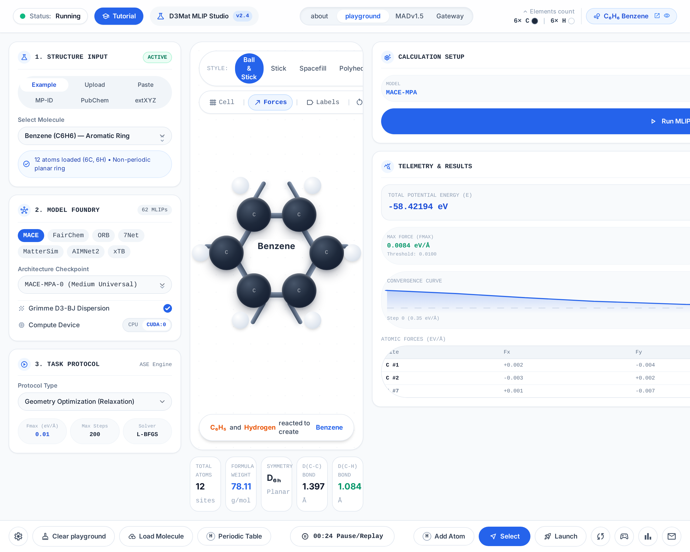

# 🧪 D3Mat: MLIP Studio — Universal Machine Learning Interatomic Potentials Playground

[](https://share.streamlit.io/)
[](https://www.python.org/downloads/)
[](LICENSE)

**D3Mat: MLIP Studio** is an interactive web-based atomistic simulation playground for running, testing, and benchmarking **62 state-of-the-art universal machine learning interatomic potentials (MLIPs)** across molecules, crystalline materials, surfaces, and trajectories.

Designed with **Google Stitch**, the UI features a clean, responsive 3-column scientific workbench with live 3D WebGL visualization (`py3Dmol`), automated geometry relaxation (`ASE`), force vector overlays, and real-time convergence telemetry.



---

## ✨ Key Features

- **7 Flexible Structure Input Modes**:
  1. **Example Library**: Pre-loaded molecules (`Benzene`, `Water`, `Methane`, `Ethane`, `Caffeine`, `CO2`, `CO`) and periodic crystals (`Silicon Diamond Bulk`, `Copper FCC Bulk`).
  2. **File Upload**: Supports `.xyz`, `.cif`, `POSCAR`, `CONTCAR`, `.vasp`, `.mol`, `.sdf`, and `.tmol`.
  3. **Paste Coordinates**: Direct text parser for `XYZ`, `CIF`, `extXYZ`, `POSCAR (VASP)`, `Turbomole`, and `MOL`.
  4. **Materials Project (`MP-ID`)**: Quick reference crystals (`mp-149`, `mp-30`, `mp-22862`, `mp-1265`, `mp-66`, `mp-13`) and custom MP API lookup.
  5. **PubChem 3D Fetcher**: Live 3D conformer retrieval by PubChem CID or chemical name.
  6. **extXYZ Trajectory Viewer**: Multi-frame trajectory inspector with interactive frame scrubbing.
  7. **Batch Mode**: Upload and evaluate multiple structures simultaneously.
- **11 Foundation MLIP Families (62 Models)**:
  - **MACE** (`MACE-MPA-0`, `MACE-OMAT`, `MACE-MATPES r2SCAN/PBE`, `MACE-MP-0a/0b/0b2/0b3`, `MACE-OFF23`)
  - **FairChem (Meta FAIR)** (`UMA Small/Medium`, `eSEN MD/SM All OMOL`, `EquiformerV2`)
  - **ORB (Orbital Materials)** (`ORB-v3 Conservative/Direct`, `ORB-v2`, `ORB-D3`)
  - **7Net (SevenNet)** (`SevenNet-MF-ompa`, `SevenNet-0`, `SevenNet-l3i5`, `SevenNet-omat24`)
  - **MatterSim (Microsoft Research)** (`MatterSim-v1 5M / 1M`)
  - **AIMNet2** (`wB97M-D3`, `B97-3c`, `AIMNet2-NSE`)
  - **UPET (EPFL COSMO)** (`PET-MAD v1.5 / v1.0`, `PET-OMAT`)
  - **xTB**, **D3 Dispersion (Grimme D3-BJ)**, **UFF / EMT**, and **In-House** checkpoints.
- **Interactive 3D Viewport & Telemetry**:
  - Switch between `Ball & Stick`, `Stick`, `Spacefill`, and `Polyhedra` styles.
  - Toggle `Unit Cell` boundaries, `3D Force Arrows`, and `Atom Labels`.
  - Real-time optimization convergence sparklines (`L-BFGS`, `BFGS`, `FIRE`), Cartesian atomic forces table, and one-click `.xyz` export.
  - Built-in **Generate Material** supercell builder, **Periodic Table** element picker, and **MADv1.5 / MADv1** benchmark explorers.

---

## 🚀 Quick Start (Local Installation)

```bash
# 1. Clone the repository
git clone https://github.com/<your-username>/D3Mat.git
cd D3Mat

# 2. Create and activate a virtual environment (Python 3.10 - 3.12 recommended)
python -m venv .venv
source .venv/bin/activate        # Linux / macOS
# .venv\Scripts\activate         # Windows PowerShell

# 3. Install core dependencies
pip install -r requirements.txt

# (Optional) Install all additional MLIP foundation model backends
pip install -r requirements-ml.txt

# 4. Launch the Streamlit application
streamlit run app.py
```

> **Note:** Even if optional GPU model weights are not installed locally, `D3Mat: MLIP Studio` includes an automatic **ASE Physics Fallback Engine** so you can test the full UI, geometry optimizations, and 3D force visualizations immediately out of the box.

---

## ☁️ One-Click Cloud Hosting from GitHub

This repository is pre-configured for three popular GitHub hosting workflows:

### 1. Streamlit Community Cloud (Recommended)
1. Push this repository to GitHub.
2. Go to [share.streamlit.io](https://share.streamlit.io/) and click **New app**.
3. Select your `D3Mat` repository, branch `main`, and main file path `app.py`.
4. *(Optional)* In **Advanced settings → Secrets**, paste the contents of [`.streamlit/secrets.toml.example`](.streamlit/secrets.toml.example) with your `HF_TOKEN` (for gated FairChem/UMA models).
5. Click **Deploy!**

### 2. GitHub Codespaces
- Click **Code → Codespaces → Create codespace on main** directly on GitHub.
- The included [`.devcontainer/devcontainer.json`](.devcontainer/devcontainer.json) automatically installs `requirements.txt` and forwards port `8501`.

### 3. Docker / Hugging Face Spaces
```bash
docker build -t d3mat-studio .
docker run -p 8501:8501 d3mat-studio
```

---

## 📁 Repository Structure

```text
D3Mat/
├── app.py                        # Main D3Mat MLIP Studio Streamlit application
├── stitch_reference.html         # Exported Google Stitch UI HTML/Tailwind design reference
├── structures/                   # Sample molecular XYZ structures (Benzene, Water, Caffeine, etc.)
├── assets/
│   └── ui_preview.png            # Stitch UI screenshot preview
├── .streamlit/
│   ├── config.toml               # Light Playground theme configuration
│   └── secrets.toml.example      # Template for HF_TOKEN and MP_API keys
├── .devcontainer/
│   └── devcontainer.json         # GitHub Codespaces configuration
├── .github/workflows/
│   └── ci.yml                    # GitHub Actions CI syntax & dependency validation
├── Dockerfile                    # Container build for cloud deployment
├── requirements.txt              # Default cloud deployment dependencies
├── requirements-ml.txt           # Full optional MLIP backends
└── LICENSE                       # MIT License
```

---

## 📄 License & Acknowledgments

Released under the [MIT License](LICENSE). Individual foundation models (such as MACE, FairChem, ORB, SevenNet, MatterSim, and AIMNet2) are governed by their respective open-source or academic licenses cited directly inside the **Model Foundry** panel.
